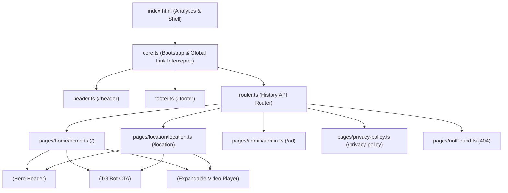

# Architecture Overview: meditation.uz

Системная архитектура клиентского SPA-приложения **meditation.uz** — лендинга и информационного портала бесплатных коллективных медитаций и асана-классов в Ташкенте с интеграцией Telegram-бота и сквозной веб-аналитики.

Связанные документы:
- [.agents/glossary/index.md](file:///d:/_sites/meditation.uz/.agents/glossary/index.md) — терминология доменной модели (`!роутер`, `!видеоплеер`, `!кнопкаБота`, `!аналитика`, `!шапка`, `!страницы`).
- [docs/PROJECT_CONTEXT.md](file:///d:/_sites/meditation.uz/docs/PROJECT_CONTEXT.md) — компактная выжимка контекста для AI-ассистента.
- [docs/ANALYSIS_REPORT.md](file:///d:/_sites/meditation.uz/docs/ANALYSIS_REPORT.md) — технический аудит и рекомендации по улучшению.

---

## 1. Структура монорепозитория (Workspace Layout)

Проект организован как `npm workspaces` с внешним Git-субмодулем `_base`:

```
meditation.uz/
├── client/          # Frontend SPA: Vite 7 + TypeScript 6 + SCSS + Custom Elements
├── _base/           # Git-субмодуль: базовые утилиты (EventEmitter, SCSS миксины, конфиги)
├── .agents/         # Конфигурация AI-агента: глоссарий, правила, скиллы
├── .tools/          # Инструменты разработки (snap.ts — генератор слепка проекта)
├── docs/            # Архитектурный контекст и документация
└── .tasks/          # Трекер проектных задач (..task)
```

---

## 2. Клиентский слой (`client/src`)

Клиент построен на чистом TypeScript (Vanilla TS) и нативных Web Components (Custom Elements) без сторонних runtime-зависимостей для мгновенной загрузки и минимального размера бандла.



### 2.1. Ядро и маршрутизация (`core.ts`, `router.ts`, `types.ts`)
- **[`core.ts`](file:///d:/_sites/meditation.uz/client/src/core.ts)**:
  - Точка входа приложения, подключаемая в [`index.html`](file:///d:/_sites/meditation.uz/client/index.html#L79).
  - Инициализирует глобальные слоты [`renderHeader()`](file:///d:/_sites/meditation.uz/client/src/components/header.ts#L3) и [`renderFooter()`](file:///d:/_sites/meditation.uz/client/src/components/footer.ts#L1), затем вызывает первичный [`render()`](file:///d:/_sites/meditation.uz/client/src/router.ts#L49).
  - Перехватывает клики по внутренним ссылкам `<a>` (`history.pushState`), игнорируя внешние ссылки, `target="_blank"` и `.pdf`-файлы, а также слушает событие `window.popstate`.
- **[`router.ts`](file:///d:/_sites/meditation.uz/client/src/router.ts)**:
  - Сопоставляет `window.location.pathname` с таблицей `routes` (поддерживает статические пути и динамические параметры `:param`).
  - Использует динамический `import()` для ленивой подгрузки страниц (code-splitting).
  - При рендере инжектирует `html` в `<main id="main">`, обновляет `document.title`, выставляет `document.body.className = pageClass`, вызывает хук `init?.()`, диспатчит событие `CustomEvent("pagerendered")` на `window` и выполняет плавный скролл к якорю (`scrollToHash()`).

### 2.2. Страницы (`client/src/pages`)
Каждая страница реализует тип [`Page`](file:///d:/_sites/meditation.uz/client/src/types.ts#L8) и возвращает объект [`PageResult`](file:///d:/_sites/meditation.uz/client/src/types.ts#L1) (`{ html, title?, init?, pageClass? }`):
- **[`homePage`](file:///d:/_sites/meditation.uz/client/src/pages/home/home.ts#L8)** (`/`): главный лендинг (описание практики, расписание субботней встречи и асана-класса, блок локации с Яндекс/Google картами, видео-маршрут, блок о ведущем, CTA-кнопки записи через Telegram-бота).
- **[`locationPage`](file:///d:/_sites/meditation.uz/client/src/pages/location/location.ts#L9)** (`/location`): отдельная страница деталей встречи, карты проезда («Eco Art Hotel»), видео-инструкции и расписания.
- **[`adminPage`](file:///d:/_sites/meditation.uz/client/src/pages/admin/admin.ts#L56)** (`/ad`): панель управления аналитикой для владельца/тестировщиков — позволяет отключать GTM, Meta Pixel и собственную статистику через `localStorage` (`off_GTM`, `off_Pixel`, `off_MyStat`) и задавать идентификатор `good_visiter`.
- **[`privacyPolicyPage`](file:///d:/_sites/meditation.uz/client/src/pages/privacy-policy.ts#L4)** (`/privacy-policy`): политика конфиденциальности и правила сбора данных через Meta Pixel.
- **[`notFoundPage`](file:///d:/_sites/meditation.uz/client/src/pages/notFound.ts#L4)** (`*`): страница 404 с возвратом на главную.

### 2.3. Нативные Web Components (`client/src/components`)
Компоненты реализованы через стандарт Custom Elements (`customElements.define`) в Light DOM с импортом SCSS и raw HTML-шаблонов (`?raw`):
- **[`CTop`](file:///d:/_sites/meditation.uz/client/src/components/c-top/c-top.ts#L3)** (`<c-top>`): верхняя шапка-герой с фотографией ведущего и плашкой-ссылкой «МЕДИТАЦИЯ В ТАШКЕНТЕ».
- **[`CAnhToBot`](file:///d:/_sites/meditation.uz/client/src/components/c-anh-to_bot.ts#L1)** (`<c-anh-to_bot>`): конверсионная кнопка перехода в Telegram-бот. Считывает `data-bot-url` (или `VITE_BOT_URL`), `data-attr`, `btn-text`, `data-class`. При клике отправляет цель `guestTrack("goalBtnClick")`, считывает `localStorage.getItem("guestID")` и открывает `${botUrl}?start=${attr}__${guestID}`.
- **[`CVPlayer`](file:///d:/_sites/meditation.uz/client/src/components/c-v-player/c-v-player.ts#L16)** (`<c-v-player>`): кастомный видеоплеер для вертикального видео (соотношение 14:9). В свёрнутом состоянии показывает превью-постер (`data-poster`). По клику плавно раскрывается (`is-expanded`), доскролливает страницу к началу плеера и запускает видео (`data-src`), отображая прогресс-полоску `.vp-strip` и генерируя события просмотра `vp:start`, `vp:half` (≥50%), `vp:complete` (≥95%).

---

## 3. Сквозная аналитика и трекинг

В [`index.html`](file:///d:/_sites/meditation.uz/client/index.html#L6-L60) интегрированы три контура аналитики:

| Система | Идентификатор / Источник | Флаг отключения (`localStorage`) | Отслеживаемые события |
| :--- | :--- | :--- | :--- |
| **Ishvara Tracker** | `trackerProjectID = 10` (`https://i.esho.uz/tracker.js`) | `off_MyStat` | `goalBtnClick` (переход в бот), `btnMaps` (клик по картам), `v:start`, `v:half`, `v:complete` (просмотр видео), генерация `guestID` |
| **Google Tag Manager** | `GTM-KM4SGH5C` | `off_GTM === "true"` | `gtm.js` / PageView |
| **Meta Pixel** | `1280952990820782` | `off_Pixel === "true"` | `PageView`, `Lead` |

---

## 4. Стилизация и ассеты (`client/src/styles`, `assets`, `public`)

- **Шрифты**: локальные `woff2` начертания `Montserrat` (400 regular, 400 italic, 600 semi-bold) в `client/src/assets/fonts/`.
- **Брейкпоинты** ([`breakpoints.scss`](file:///d:/_sites/meditation.uz/client/src/styles/breakpoints.scss)):
  - `mobile`: `max-width: 480px`
  - `tablet`: `min-width: 768px` (контейнер расширяется с `576px` до `800px`)
  - `laptop`: `min-width: 1024px`
  - `desktop`: `min-width: 1280px`
- **Алиасы путей** ([`vite.config.ts`](file:///d:/_sites/meditation.uz/client/vite.config.ts#L10-L20) / [`client/tsconfig.json`](file:///d:/_sites/meditation.uz/client/tsconfig.json#L22-L30)):
  - `@` -> `client/src`
  - `@components` -> `client/src/components`
  - `@pages` -> `client/src/pages`
  - `@assets` -> `client/src/assets`
  - `@styles` -> `client/src/styles`
  - `@base` -> `_base`

---

## 5. Потоки данных (Data Flows)

### 5.1. Жизненный цикл SPA-навигации
```
[User Click <a href="/location"> / popstate]
       │
       ▼
[core.ts: e.preventDefault() + history.pushState()]
       │
       ▼
[router.ts: render() -> matchRoute(routes, pathname)]
       │
       ▼
[Dynamic import() страницы -> page(params)]
       │
       ▼
[main.innerHTML = html; document.title; body.classList]
       │
       ▼
[Custom Elements connectedCallback() + page.init()]
       │
       ▼
[window.dispatchEvent("pagerendered") + scrollToHash()]
```

### 5.2. Воронка конверсии и сквозной трекинг (Сайт -> Telegram-бот)
```
[Загрузка страницы] ──► [tracker.js инициализирует localStorage.guestID]
       │
       ▼
[Клик по <c-anh-to_bot>]
       │
       ├──► [window.guestTrack("goalBtnClick")] ──► [Ishvara Tracker API]
       │
       └──► [window.open("https://t.me/uzmeditation_bot?start=meditation__<guestID>")]
```

---

## 6. Инфраструктура и развёртывание (Deployment)

- **Хостинг**: [Vercel](https://vercel.com/) — конфигурация в [`vercel.json`](file:///d:/_sites/meditation.uz/vercel.json).
- **Сборка**: `npm run build:client` (`tsc && npx vite build`), выходная директория `client/dist`.
- **Маршрутизация на хостинге**: все запросы `/(.*)` перенаправляются на `/index.html` для работы History API роутера; для `.pdf` файлов выставляется заголовок `Content-Disposition: inline`.

